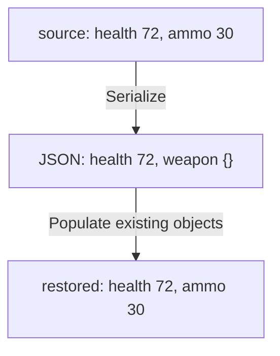

# Values, owned state, and links

Restore a player with 72 health and 30 rounds while keeping the weapon object
your game already owns. If the player also targets another entity, save that
entity's stable ID so the game can bind the reference to the corresponding
object in the restored world.

Start with the [player walkthrough](getting-started.md) for the complete types.
A **runtime shell** is the player and any owned objects that the host creates
and initializes before handing them to `Populate`.

## One schema, ordered by code

Every recordable type implements
<xref:Chronicler.IRecordable.RecordData(Chronicler.IChronicler)>:

```csharp
public void RecordData(IChronicler chronicler)
{
    RecordValues.Look(chronicler, ref Health, "health", 100);
    RecordDeep.Look(chronicler, ref Weapon, "weapon");
}
```

Each pass calls `RecordData` directly. Its statements determine processing
order, field names, defaults, and how each field maps to the runtime shell. Leaf
values use the selected transport's own serialization rules.

In the walkthrough, the writer reads `source` and emits 72 health and an empty
weapon record. The reader restores 72 health and 30 rounds in the host-created
`restored` player and its existing weapon.



<a id="pick-a-lane-by-ownership"></a>

## Choose by state ownership

| Field or state kind                 | Helper                               | Load when the entry is missing or null                    |
| ----------------------------------- | ------------------------------------ | --------------------------------------------------------- |
| `Health` or `Ammo`, a leaf value    | <xref:Chronicler.RecordValues>       | Assign the declared default.                              |
| `Weapon`, an owned class            | <xref:Chronicler.RecordDeep>         | Keep the existing reference and state.                    |
| Owned recordable struct             | <xref:Chronicler.RecordDeepStruct>   | Run the schema on a fresh value with an empty reader.     |
| Optional recordable struct          | <xref:Chronicler.RecordNullableDeep> | Assign `null`.                                            |
| `Target`, an object owned elsewhere | <xref:Chronicler.RecordLinks>        | Assign `default(T)` and invoke the callback, if supplied. |

### Values

Use <xref:Chronicler.RecordValues> for leaf state. Pass the canonical default
explicitly:

```csharp
RecordValues.Look(chronicler, ref Health, "health", 100);
```

Both writers omit null leaf values and values equal to the declared default.
When `health` is absent or null during loading, the field becomes `100`
regardless of the target object's previous value.

### Owned nested state

A present `"weapon": {}` runs the weapon's schema, so missing `ammo` resets its
count to 30. A missing or null `weapon` entry skips the weapon's schema
entirely. If the payload contains a weapon record and the target's `Weapon` is
null, `Populate` throws `InvalidOperationException`. The host owns construction,
pooling, and runtime registration.

A present deep struct runs its schema directly on a fresh value. Validation in
that schema can reject missing required fields, including when
`RecordDeepStruct` uses the empty reader for a missing entry.

### Runtime-owned or external links

Use <xref:Chronicler.RecordLinks> to store the ID of an object owned elsewhere.
A **stable ID** is a key the host can assign to corresponding objects across
runs. Here the source and restored worlds each have their own instance of
`player-42`. Each <xref:Chronicler.ChronicleContext> carries the
<xref:Chronicler.ChronicleLinkRegistry> for its session.

```csharp
using System;
using Chronicler;
using Chronicler.Serialization;

RuntimeEntity sourceTarget = new();
ActorState actorState = new() { Target = sourceTarget };
ChronicleContext saveContext = new();
saveContext.Links.RegisterInstance("player-42", sourceTarget);
string json = JsonRecordSerializer.Serialize(actorState, saveContext);
Console.WriteLine(json); // {"target":"player-42"}

RuntimeEntity restoredTarget = new();
ActorState restoredActorState = new();
ChronicleContext loadContext = new();
loadContext.Links.RegisterInstance("player-42", restoredTarget);
JsonRecordSerializer.Populate(restoredActorState, json, loadContext);
Console.WriteLine(ReferenceEquals(restoredActorState.Target, restoredTarget)); // True

public sealed class ActorState : IRecordable
{
    public RuntimeEntity? Target;

    public void RecordData(IChronicler chronicler)
    {
        RecordLinks.Look(chronicler, ref Target, "target");
    }
}

public sealed class RuntimeEntity { }
```

The registry can use a custom <xref:Chronicler.IRecordLinkResolver`1> before
falling back to explicit registrations. It looks up the declared link type and
optional `slot`, which lets the same type participate in separate identity
domains. Use matching types and slots on both ends.

| Method on `RecordLinks` | When it assigns the target                                                                     |
| ----------------------- | ---------------------------------------------------------------------------------------------- |
| `Look`                  | When reading the field. An unresolved ID throws `InvalidOperationException`.                   |
| `LookDeferred`          | When the target becomes available during the load. The method requires an assignment callback. |

After the root `RecordData` call returns, the serializer retries queued links
until they resolve or a pass makes no progress. It throws
`InvalidOperationException` for any remaining IDs. Saving a non-null link
without a stable ID also throws `InvalidOperationException`. Population can
apply earlier fields or callbacks before reporting a failure.

## Transport behavior

<xref:Chronicler.Serialization.JsonRecordSerializer> and, in the standard
package, <xref:Chronicler.Serialization.MemoryPackRecordSerializer> implement
the same <xref:Chronicler.IChronicler> contract. They both:

- call the type-owned schema directly;
- populate an existing target;
- apply declared defaults for missing values;
- use a context for stable links;
- resolve deferred links after loading.

Read each payload with the serializer that wrote it. Format, leaf codecs, and
parsing errors are transport-specific.

## State-backed JSON types

<xref:Chronicler.IStateBacked`1> covers a separate System.Text.Json integration
for helper objects that expose one canonical state value. Register
<xref:Chronicler.Serialization.StateJsonConverterFactory> when each record type
implements one `IStateBacked<TState>` contract and has a public constructor
accepting that exact state type:

```csharp
var options = new JsonSerializerOptions();
options.Converters.Add(new StateJsonConverterFactory());
```

The converter writes an object with a single `State` property and reconstructs
the helper from that state constructor. This is not the same as populating an
`IRecordable` runtime shell; use it only when construction from canonical state
is the intended contract.

The factory discovers the state contract through reflection and compiles a
constructor delegate. When the types are known, register a
`StateJsonConverter<TRecord, TState>` with an explicit factory instead. The
state payload still follows System.Text.Json's configured serialization rules.

## Payload editing

<xref:Chronicler.Serialization.SerializationPayloadEditor> can remove or replace
entries in a serialized payload. It is useful for compatibility tests and
controlled schema migrations. Use the method for your format. JSON is available
in both Core packages. MemoryPack requires the standard package.

| Payload               | Set or remove an entry                        |
| --------------------- | --------------------------------------------- |
| JSON (`string`)       | `SetJsonValue`, `RemoveJsonProperty`          |
| MemoryPack (`byte[]`) | `SetMemoryPackValue`, `RemoveMemoryPackEntry` |

To test loading an older player payload without an `ammo` entry, start with the
[walkthrough](getting-started.md). Add these lines before the declarations in
`Program.cs`. The first edit sets the recorded ammo to 7. The second removes
that entry, so population restores the declared default of 30.

```csharp
string edited = SerializationPayloadEditor.SetJsonValue(json, 7, "weapon", "ammo");
JsonRecordSerializer.Populate(restored, edited);
Console.WriteLine(restored.Weapon.Ammo); // 7

edited = SerializationPayloadEditor.RemoveJsonProperty(edited, "weapon", "ammo");
JsonRecordSerializer.Populate(restored, edited);
Console.WriteLine(restored.Weapon.Ammo); // 30
```

Use recorded names in paths, from the outer object to the field. The parent
record must exist. A missing intermediate record throws
`InvalidOperationException`, and removing an absent final entry is a no-op for
the recorded state. The editor serializes replacement values directly with the
selected transport. Only the subsequent population runs `RecordData`.

## Host integration lifecycle

<xref:Chronicler.DefaultSaver> provides `Save`, `EarlyApply`, `Apply`, and
`LateApply` hooks for host integrations. For example, an engine editor adapter
can use them to transfer settings and configuration between editor-owned data
and a library. The host decides when to invoke each phase; Chronicler does not
depend on an engine or automatically run the lifecycle during serialization.

## Package boundaries

Both [Core packages](../index.md#package-family) include recording helpers, JSON
and its payload editor, record hashes, and link services. The standard package
adds MemoryPack and its payload editor. The independent <xref:MemoryPack> shim
supplies compatibility attributes for annotated Lean assemblies.

Continue with [Deterministic record hashes](record-hashes.md) when the goal is
state comparison rather than transport.
