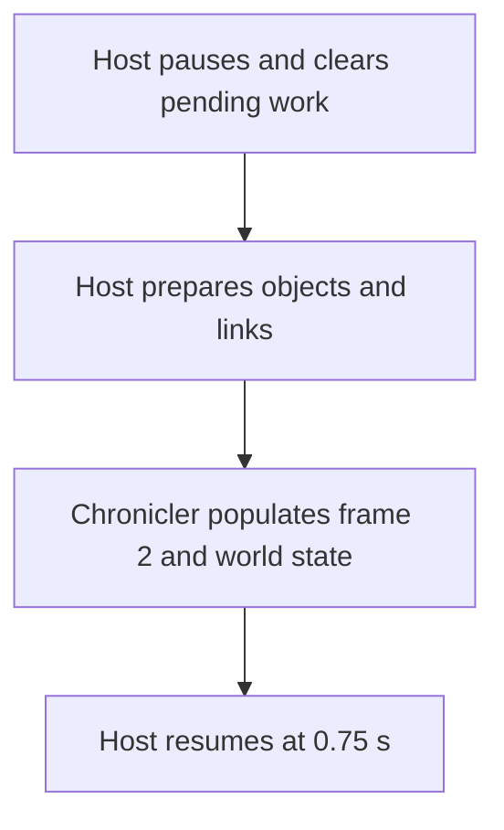

# Simulation timing

Advance a simulation clock twice, save it at frame 2 with 0.75 seconds elapsed,
then restore it and advance once more. The restored clock reaches frame 3 at
exactly 1 second. The host controls when each step runs.

<xref:Chronicler.Timing.ChronicleTimestamp> is an instant measured from the
simulation's origin. <xref:Chronicler.Timing.ChronicleDuration> is a signed
interval, such as the time added by one step. Both are immutable and available
in the standard and Lean packages without a math-library or engine dependency.

See [arithmetic and boundaries](#arithmetic-and-boundaries) for overflow and
range rules, and [record values and clock state](#record-values-and-clock-state)
for schema order and load failures.

## Advance a clock explicitly

<xref:Chronicler.Timing.ChronicleClock> starts at frame/time zero and advances
only when its owner calls `Advance()`. Supply a positive step; there is no
default frame rate. `FrameCount` is a signed `long`, and `ElapsedTime`
accumulates each actual step. Changing `StepDuration` affects future advances,
never history.

Start with a half-second step. At frame 1, switch to quarter-second steps. Set a
deadline two advances from the start and save when the clock reaches it. Paste
this into a console app that references either Core package.

```csharp
using System;
using Chronicler.Serialization;
using Chronicler.Timing;

var halfSecond = new ChronicleDuration(0, 0x80000000);
var quarterSecond = new ChronicleDuration(0, 0x40000000);
var clock = new ChronicleClock(halfSecond);
long due = clock.GetDeadlineFrame(2);

clock.Advance(); // Frame 1, 0.5 s.
clock.SetStepDuration(quarterSecond);
clock.Advance(); // Frame 2, 0.75 s.
Console.WriteLine(clock.FrameCount >= due); // True

string snapshot = JsonRecordSerializer.Serialize(clock);
var restored = new ChronicleClock(halfSecond);
JsonRecordSerializer.Populate(restored, snapshot);
restored.Advance();
Console.WriteLine(restored.FrameCount); // 3
Console.WriteLine(restored.ElapsedTime == new ChronicleTimestamp(1, 0)); // True
```

The snapshot restores the quarter-second step as well as frame 2 and elapsed
time. The next advance adds 0.25 seconds to the restored 0.75 seconds.

`GetDeadlineFrame` adds a nonnegative offset to the current frame in checked
arithmetic. Zero selects the current frame. Step changes leave frame deadlines
fixed because they count advances. For a deadline measured in seconds, compare
`ElapsedTime` to a target timestamp. The host checks deadlines and runs the
corresponding work.

`Reset()` returns frame/time to zero while retaining the configured step.
`Advance()` rejects an exhausted frame counter with `InvalidOperationException`
or an unrepresentable timestamp with `OverflowException`, leaving all clock
state unchanged. A deadline overflow also throws `OverflowException`.
Zero/negative steps and negative deadline offsets throw
`ArgumentOutOfRangeException`.

### Restore a running world

Coordinate clock access on the host because the clock is not thread-safe. Before
resetting or restoring a running world, stop advancement and discard waits and
pending work from the old simulation lifetime. Prepare the target objects and
link registrations, restore the clock and corresponding world state, then resume
ordered input. Use the owning context's lifecycle API when it manages a private
clock.



In a world checkpoint taken at the example's frame 2, the host can resume at
0.75 seconds after restoring all state. Clock population applies all its fields
after validation. Other world objects can be partly updated on failure.

Gravitas and Trailblazer each own their clock. A host using both advances each
context once per gameplay step with matching durations; the navigation adapter
does not add another advance, synchronize rates, or repair a missed step. The
standalone `ChronicleClock` example above does not replace either context's
loop.

## Seconds and fractions

Both types store `long WholeSeconds` plus `uint FractionalSecond`. Each
fractional unit is exactly `2^-32` seconds; `0x40000000` represents a quarter
second, and `0x80000000` represents half a second. Fractions never change
precision as the simulation ages.

Whole seconds are the mathematical floor. A negative fraction is represented by
a negative whole part plus a nonnegative fraction.

| Value                        | Seconds |        Fraction |
| ---------------------------- | ------: | --------------: |
| Zero                         |       0 |               0 |
| Half a second                |       0 |    `0x80000000` |
| Negative half a second       |      -1 |    `0x80000000` |
| Negative one fractional unit |      -1 | `uint.MaxValue` |

Every duration component pair is canonical. Timestamps reject negative whole
seconds with `ArgumentOutOfRangeException`. The default value of either type is
zero.

## Subtract instants before narrowing an interval

This complete method measures a quarter second after 100 Julian years (365.25
days per year):

```csharp
using Chronicler.Timing;

public static class TimingExample
{
    public static ChronicleDuration MeasureInterval()
    {
        var start = new ChronicleTimestamp(3_155_760_000, 0);
        var end = start + new ChronicleDuration(0, 0x40000000);
        return end - start; // WholeSeconds = 0; FractionalSecond = 0x40000000.
    }
}
```

The instants are large; their difference is small. Keep the difference wide
until a consumer explicitly checks whether its narrower representation can hold
it. A large interval cannot become a small numeric value without either
rejecting the conversion or losing information.

## Arithmetic and boundaries

Supported operations are duration addition/subtraction, timestamp plus a signed
duration, and timestamp subtraction. Subtracting an earlier instant from a later
one gives a positive duration; reversing them gives a negative duration. Both
directions work across the complete timestamp range.

Arithmetic throws `OverflowException` if its **final result** cannot fit. It
never wraps or saturates. A duration's range runs from `(long.MinValue, 0)`
through `(long.MaxValue, uint.MaxValue)`. A timestamp's range starts at zero and
has the same upper endpoint. Moving a timestamp before its origin is also an
overflow, even though negative durations themselves are valid.

Comparisons and equality use exact values. `GetHashCode()` uses a fixed,
process-independent component mix for collections; it is not a record hash or a
persisted schema.

## Ownership stays with the host

These values do not read a system clock, advance a simulation, or carry a
world/lifetime identifier. Compare or subtract timestamps only when the host
knows they share an origin and simulation lifetime. Resetting a world does not
make a timestamp retained from the old run meaningful in the new run.

The value types remain readonly and do not implement `IRecordable`. Their
in-memory layout is not a serialization format. Use the explicit recording
helper below instead. No Fixed64 conversion API is provided by Chronicler.

Applications using FixedMathSharp can use the optional
[`FixedMathSharp.Chronicler` companion](https://github.com/mrdav30/FixedMathSharp/blob/main/src/FixedMathSharp.Chronicler/README.md).
Its `FixedChronicleTime` widens Fixed64 seconds exactly and narrows a duration
only when it fits. Subtract wide timestamps first, then use `TryToFixed64` or
the throwing `ToFixed64` conversion. The companion also counts complete
fixed-size steps using raw integer division; that is not a wait scheduler or a
lookup of historical frame numbers. This dependency points toward Chronicler,
never from Chronicler to the math library. See the companion guide for exact
conversion examples.

## Record values and clock state

Use <xref:Chronicler.RecordChronicleTime> inside your type's `RecordData` for
either time value. This partial schema example assumes a `ChronicleDuration`
field named `cooldown` and a `ChronicleTimestamp` field named `startedAt`:

```csharp
RecordChronicleTime.Look(chronicler, ref cooldown, "Cooldown");
RecordChronicleTime.Look(chronicler, ref startedAt, "StartedAt");
```

Each value records `SchemaVersion` (int, version 1), `WholeSeconds` (long), and
`FractionalSecond` (uint), in that order. Missing components default to zero; a
missing nested record, missing schema, or unsupported version rejects. Negative
durations are valid; negative timestamps reject. A failed helper call leaves its
referenced value unchanged, not every field of the enclosing object.

The clock records version 1, `FrameCount`, nested `ElapsedTime`, then nested
`StepDuration`. Loading stages every field before applying any clock state.
Frames must be nonnegative, the step positive, and frame/time must either both
be zero or both positive. A missing frame defaults to zero; both nested schemas
are required. The clock does **not** require elapsed time to equal frame count
times the current step, because step sizes can change.

JSON and MemoryPack follow this same schema. Lean uses JSON. Missing or
unsupported schemas, negative frame counts, and inconsistent frame/time pairs
throw `InvalidOperationException`. Negative timestamps and nonpositive steps
throw `ArgumentOutOfRangeException`. Malformed transport payloads can also raise
parsing errors. When the clock's payload fails to parse or its schema fails
validation, its frame, elapsed time, and step stay unchanged.
<xref:Chronicler.Hashing.ChronicleHashSerializer> hashes the ordered schema,
including the full-width frame and fractions, without recording host identity.
